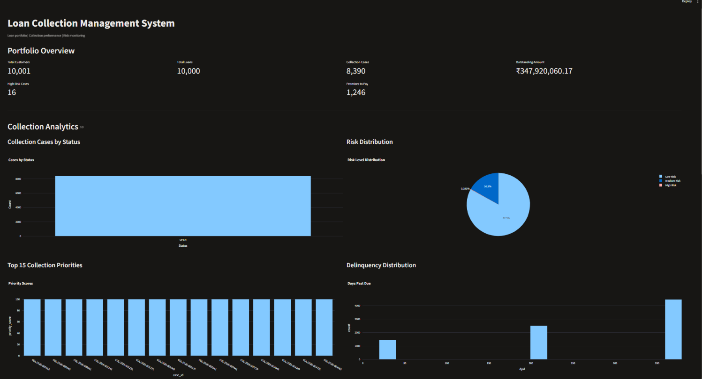

# Loan Collection Management System

A Python, MySQL and Streamlit-based application for managing loan collection data, monitoring delinquent accounts, prioritizing collection cases and tracking customer payment commitments.

## Overview

This project demonstrates a data-driven loan collection workflow using synthetic financial data. It includes synthetic dataset generation, MySQL database integration, collection analytics, data validation and an interactive dashboard.

## Technology Stack

- Python 3.14
- MySQL 8
- Streamlit
- Pandas
- Plotly
- mysql-connector-python
- Faker
- SQL

## Key Features

1. **Loan and Customer Management** – Stores and manages customer, account and loan information.
2. **EMI and Payment Tracking** – Tracks installment schedules, payments and outstanding balances.
3. **Delinquency Monitoring** – Supports Days Past Due (DPD) analysis and delinquency tracking.
4. **Risk Indicators** – Includes configured risk scenarios for collection analysis.
5. **Collection Prioritization** – Supports collection priority analysis.
6. **Collection Case Management** – Tracks collection cases and action statuses.
7. **Contact Preferences** – Stores customer communication preferences and restrictions.
8. **Contact Attempt Tracking** – Maintains customer contact attempt records.
9. **Promise-to-Pay Monitoring** – Tracks payment commitments and remaining amounts.
10. **MySQL Integration** – Stores and retrieves collection data using MySQL.
11. **Interactive Dashboard** – Displays portfolio metrics, collection analytics and customer information.
12. **Customer Management** – Supports customer search, adding customers and editing dashboard-managed customers.

## Dashboard



The application includes an interactive dashboard built using Streamlit, Pandas, Plotly and MySQL.

### Dashboard Features

- Loan collection portfolio overview
- Collection case analytics
- Outstanding balance monitoring
- Average Days Past Due (DPD) analysis
- Collection priority and risk analysis
- Collection case exploration
- Customer search
- Add new customers
- Edit dashboard-managed customers

### Run the Dashboard

From the project root directory, execute:

```bash
python -m streamlit run dashboard.py
```

Open the local URL displayed in the terminal, usually:

```text
http://localhost:8501
```

Enter your MySQL connection details in the dashboard sidebar and click **Connect to Database**.

## Project Structure

```text
Loan_Collection_Management_System/
│
├── dashboard.py
├── main.py
├── requirements.txt
├── README.md
├── .gitignore
│
├── database/
├── data/
├── docs/
├── outputs/
├── src/
├── tests/
│
└── synthetic_data_v2/
    ├── README.md
    ├── data_dictionary.md
    ├── generate_dataset.py
    ├── export_sql.py
    └── output/
        ├── accounts.csv
        ├── customers.csv
        ├── loans.csv
        ├── payments.csv
        ├── collection_cases.csv
        ├── installments.csv
        ├── contact_attempts.csv
        ├── contact_preferences.csv
        ├── delinquency_snapshots.csv
        ├── promises_to_pay.csv
        ├── risk_indicators.csv
        ├── ground_truth.csv
        ├── schema.sql
        └── seed_data.sql
```

## Synthetic Dataset

The project includes a synthetic loan collection dataset generated for demonstration, testing and analysis.

It contains records for:

- Customers
- Accounts
- Loans
- Installments
- Payments
- Collection cases
- Contact preferences
- Contact attempts
- Delinquency snapshots
- Promises to Pay
- Risk indicators
- Ground-truth validation scenarios

### Dataset Size

- 10,000 loans
- 8,390 collection cases

For additional information about dataset generation, entity relationships and column definitions, refer to:

- `synthetic_data_v2/README.md`
- `synthetic_data_v2/data_dictionary.md`

## Installation and Setup

### 1. Clone the Repository

```bash
git clone https://github.com/ramcharankalvala/Loan_Collection_Management_System-Copy.git

cd Loan_Collection_Management_System-Copy
```

### 2. Create a Virtual Environment

```bash
python -m venv .venv
```

Activate it on Windows PowerShell:

```powershell
.\.venv\Scripts\Activate.ps1
```

### 3. Install Dependencies

```bash
python -m pip install -r requirements.txt
```

### 4. Configure MySQL

1. Install and start MySQL Server 8.
2. Open MySQL Workbench or the MySQL command-line client.
3. For a fresh database setup, import `synthetic_data_v2/output/schema.sql`.
4. Import `synthetic_data_v2/output/seed_data.sql` to populate the database.
5. The database name is `loan_collection_synthetic`.
6. Start the Streamlit dashboard and enter your MySQL host, port, username and password in the sidebar.

**Important:** The supplied `schema.sql` drops and recreates existing tables. Import it only when creating a fresh database or intentionally resetting the dataset. Do not run it against a database containing records you want to preserve.

Never publish database passwords, private credentials or production customer information to GitHub.

## Run the Application

### Launch the Streamlit Dashboard

```bash
python -m streamlit run dashboard.py
```

### Run the Main Python Application

```bash
python main.py
```

## Synthetic Data Generation

To generate the synthetic dataset, run:

```bash
python synthetic_data_v2/generate_dataset.py
```

Refer to `synthetic_data_v2/README.md` for dataset generation and export details.

## Notes and Limitations

- All included financial and customer records are synthetic.
- The project is intended for educational, demonstration and testing purposes.
- Risk indicators and priority scenarios are configured demonstration values, not predictions from a trained machine-learning model.
- The application requires a locally configured MySQL database.
- The dashboard supports customer search, adding customers and editing dashboard-managed customers.
- A REST API and live customer communication integration are not included.
- `main.py` currently displays a project menu; it is not an end-to-end workflow runner.

## Author

**Ramcharan Teja**

Python | SQL | MySQL | Streamlit | Data Processing